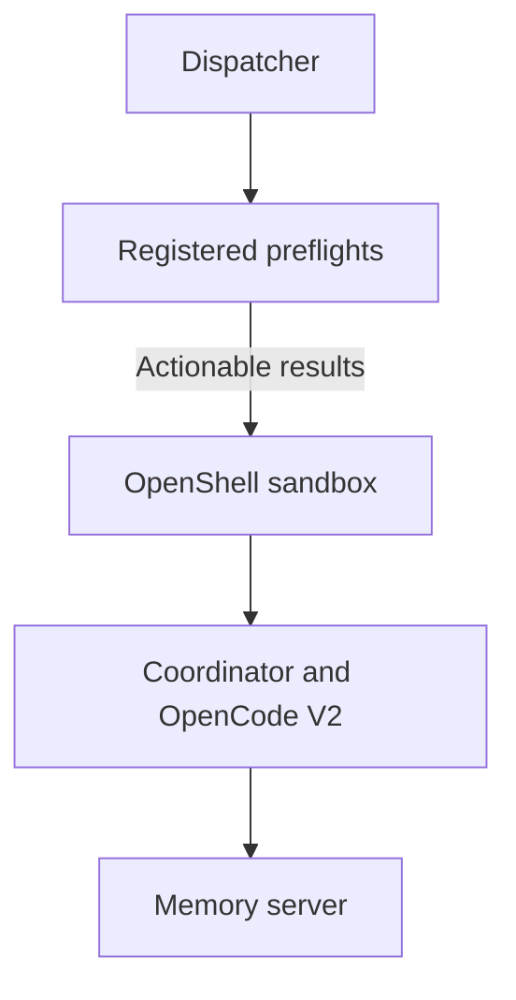

# Architecture

The dispatcher decides when to run work. OpenShell provides an isolated runtime. The coordinator runs one OpenCode V2 cycle and records its outcome.

| Component | Responsibility |
|---|---|
| [Dispatcher](packages/agent-dispatcher/README.md) | Sync instance profiles, decide whether to launch, coordinate per-agent admission, and clean up sandboxes. |
| [Preflight registry](packages/preflights/README.md) | Validate instance parameters and deterministically check for work before spending model tokens. |
| [OpenShell](docs/openshell-deployment.md) | Create a per-run environment with filesystem and network policy enforced outside the model runtime. |
| [Coordinator](coordinator/README.md) | Consume the one-shot input, prepare runtime configuration, supervise the OpenCode session, and normalize events. |
| [Memory server](docs/team-memory.md) | Persist task state, transcripts, and usage across runs. |
| [Gateway and proxy](docs/agent-proxy-gateways.md) | Authenticate requests and keep upstream vendor credentials outside the sandbox. |

The dispatcher supplies only `start` results to the sandbox; it does not launch on `skip` or `error` alone. The runner consumes the input once without rerunning preflights. See the [cycle contract](docs/bot-workflow-loop.md) and [credential boundaries](docs/dispatcher-secrets.md).

## Search snapshot credential boundary

The optional `UPLOAD_MEMORY_PASSWORD` shared credential authorizes PR/MR-label snapshot ingestion and existing memory uploads. It is reserved for trusted preflight subprocesses, removed from agent environments, and forbidden in MCP configuration (including arguments, env values and headers) before interpolation. It must not be provisioned through instance/model configuration or exposed to agent tools.

**Release blocker:** environment/configuration filtering is not a process-isolation boundary. In a shared-UID container, a sanitized child can read a parent's initial environment through `/proc`; removing the variable does not erase that copy. Do not provision this credential to a runner that executes model/tool subprocesses. The ingestion writer needs a separate trusted runner/proxy boundary before enabling it; the unsafe sandbox secret example has been removed.
