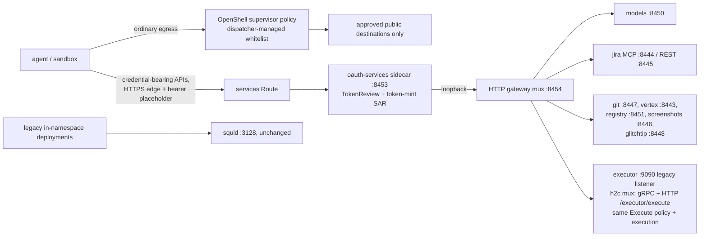

# Agent Proxy Gateways (REHOR-251/252/253)

One authenticated, path-routed HTTP OpenShift gateway in front of the existing proxy services, plus a centrally owned sandbox egress policy. New gateway and egress flags are **disabled by default**. No public gRPC or forward-proxy endpoint is added. Legacy Squid, proxy endpoints and internal gRPC remain until all agents migrate.

**Hard requirement:** after the updated proxy deployment plus the runner submodule bump, there is **zero per-instance configuration** — no manual env changes for legacy deployments.

## Scope

Cross-cluster sandboxed agents cannot reach in-namespace ClusterIP services, so every credential-injecting proxy behind `devbot-proxy` needs an authenticated public entry point. The model gateway already provides one pattern (oauth-proxy Route, REHOR-237). This work adds **one** public endpoint, pointing at the existing proxy pod:

- **Services HTTP gateway** (REHOR-251/252): one edge-terminated, oauth-proxy-authenticated Route multiplexing the existing HTTP listeners — including the executor command API — behind fixed path prefixes.

Ordinary (non-credential-bearing) sandbox egress is **not** proxied through a new public endpoint: it is centrally managed by the dispatcher's OpenShell supervisor policy whitelist, migrated from the existing Squid allowlist (REHOR-253 — see [Egress policy migration](#egress-policy-migration-rehor-253)). Credential-bearing APIs stay on this hub proxy; vendor credentials are never delivered through OpenShell.

There is **no public gRPC endpoint and no public forward proxy**. The existing executor listener (`EXECUTOR_LISTEN`, `:9090` in-cluster or the unix socket in local dev) is retained and serves **both** protocols: legacy gRPC (HTTP/2) and the new HTTP/1.1 `POST /executor/execute`, multiplexed on the same listener. Older gRPC clients continue on the same port, unchanged. Squid keeps running on `:3128` for legacy deployments, unchanged.

The deploy wiring lives in [`deploy/template.yaml`](https://github.com/OpenShift-Fleet/rehor/blob/master/deploy/template.yaml) (`${PROXY_NAME}-gateways` Service, services Route and `oauth-services` sidecar). Server-side Go lives in `proxy/executor/http_gateway.go`, `executor_http.go` and `cmd/server/gateways.go`. Thin-client changes live in `proxy/executor/cmd/client` and the coordinator environment handling; they deploy with the runner image.

## Architecture



| Gateway | Route (default name) | Termination | Listen port | Authenticated by |
|---|---|---|---|---|
| Services HTTP (incl. executor) | `${PROXY_NAME}-services` | edge (HTTP→HTTPS redirect) | oauth-proxy sidecar `:8453` → loopback mux `:8454` | oauth-proxy (TokenReview + SAR) |

The Route selects the existing proxy pod through the `${PROXY_NAME}-gateways` ClusterIP Service, which exposes only `:8453`. The loopback `:8454` mux is internal-only and deliberately absent from the Service and the NetworkPolicy; the executor HTTP endpoint lives on the **existing** `:9090`/unix listener, so no new port is opened anywhere. No metrics port is exposed: `:9091` stays reachable only from `openshift-customer-monitoring` via the existing NetworkPolicy, which admits router traffic only to `:8453`.

Existing ports (Squid `:3128`, executor `:9090`, `:8443`–`:8451`, model-auth `:8452`) and the model Route `${PROXY_NAME}-model` are unchanged. In-namespace callers keep using ClusterIP addresses directly, e.g. `http://devbot-proxy:8450`.

## HTTP services gateway (REHOR-251)

A single authenticated Route fronts a fixed path-prefix multiplexer (`http_gateway.go`, `NewHTTPGateway`). Routing is a compile-time table; no request path, header, query, or body can select or modify an upstream. The mux is **not** an authentication boundary — the `oauth-services` sidecar owns identity checks, using the same tight SAR as the model gateway (not the memory dashboard's broad `projects/list` rule).

| Gateway path | Backend (loopback) | Path rewriting | Notes |
|---|---|---|---|
| `/v1/...` | models `:8450` | none — canonical root | OpenAI-compatible model gateway; the coordinator/dispatcher currently require a model base URL of exactly `/v1` |
| `/models/v1/...` | models `:8450` | strips `/models` | optional alias; canonical base remains `/v1` |
| `/jira/mcp` | Jira MCP `:8444` | exact map to `/mcp` | mcp-atlassian streamable HTTP (POST/GET/DELETE on one endpoint) |
| `/jira/rest/...` | Jira REST `:8445` | strips `/jira/rest` | |
| `/git/...` | git auth `:8447` | strips `/git` | host-prefixed git smart HTTP, see [git auth proxy](git-auth-proxy.md) |
| `/vertex/...` | Vertex `:8443` | strips `/vertex` | |
| `/v2/...` | registry `:8451` | none — canonical root | Docker Registry API has native fixed paths; docker cannot use a path-prefixed registry base URL, see [Red Hat registry proxy](redhat-registry-proxy.md) |
| `/registry/v2/...` | registry `:8451` | strips `/registry` | optional alias for `/v2` |
| `/screenshots/...` | screenshots `:8446` | strips `/screenshots` | |
| `/glitchtip/...` | GlitchTip `:8448` | strips `/glitchtip` | |
| `POST /executor/execute` | executor `:9090` (legacy listener) | exact match, POST only (`405` otherwise) | see the next section |
| anything else | — | — | `404`; there is no catch-all |

Behavior details (from `http_gateway.go`): `CONNECT` is rejected with `405`; a route whose backend is not configured fails closed with `503`; `/healthz` is served by the mux itself; dot-segment and double-slash traversal is rejected with `403`; streaming responses (MCP SSE, model completions, git pack negotiation) are flushed immediately; same-origin relative `Location` headers from backends are rewritten back into the route's gateway prefix (so a backend redirect stays on its route), absolute redirects (the git smart-HTTP case) pass through unchanged.

## HTTP executor endpoint (REHOR-252)

Executor commands — the `gh`/`glab`/`gpg` shims behind the bot's credential helpers — are exposed through HTTP instead of a public gRPC endpoint. HTTP works with OpenShell's existing HTTP/1 header mediation.

**One listener, two protocols.** The existing `EXECUTOR_LISTEN` endpoint (`:9090` in-cluster, or the unix socket in local dev) serves legacy gRPC (HTTP/2) and the new HTTP/1.1 `POST /executor/execute` via an h2c mux on the same listener. Older gRPC clients continue against the same port with no change. Both protocols delegate to the **same** `Execute` implementation — identical command policy allowlist and execution. The gateway mux routes its `/executor/execute` path to this same internal listener; there is no separate wrapper listener.

- Wire format (`executor_http.go`): the canonical client body is `Content-Type: application/x-protobuf` — the **same generated `ExecuteRequest`/`ExecuteResponse` serialization and 4 MiB wire caps as the old gRPC envelope**, so the transport is user-invisible and large payloads do not regress (a JSON body's base64/escaping would shrink the usable payload). A JSON debug body is also accepted by the server; the default client is binary. Error responses are static strings that never echo command output or environment material.

**Thin clients — zero per-instance config.** Updated clients (runner image) default to HTTP and derive their target from the existing `EXECUTOR_ADDR` (host:port or unix socket); legacy deployments need no manual configuration:

| Client env | Purpose |
|---|---|
| `EXECUTOR_ADDR` | existing internal executor address; updated thin clients derive the HTTP target from it automatically |
| `EXECUTOR_TRANSPORT` | optional explicit rollback to `grpc`. There is **no silent HTTP→gRPC retry** — a failed HTTP call is never retried over gRPC (double-execution risk) |
| `EXECUTOR_HTTP_URL` | explicit public HTTPS services-Route URL for cross-cluster callers (dispatcher); sandbox callers send an `EXECUTOR_TOKEN` **placeholder** — only the exact OpenShell nonsecret marker is accepted, and only on this explicit-HTTPS path |
| `EXECUTOR_TOKEN_FILE` | **rejected by the updated client in all modes** — only the nonsecret placeholder is supported; the coordinator also blocks this env |

Proxy handling differs by mode: explicit HTTPS (`EXECUTOR_HTTP_URL`) **honors** the supervisor's `HTTP(S)_PROXY`/`NO_PROXY` environment so OpenShell's credential mediation can intercept the hop, while the derived internal TCP/unix transport ignores ambient proxy settings, as legacy did.

**Do not conflate the two executor paths.** The internal HTTP endpoint on `:9090` carries **no bearer** and has the same original NetworkPolicy boundary as legacy gRPC (in-namespace, pod-selector bounded) — it is a compatibility transport, not an authenticated public endpoint. The public path is the authenticated services Route (`EXECUTOR_HTTP_URL`), where the oauth-proxy sidecar owns identity and the gateway mux strips the bearer before dispatch. Sandbox HTTPS uses placeholders only.

Acceptance for the transport switch is **CLI-identical behavior**: the same `gh`/`glab`/`gpg` commands, the same policy decisions, and the same results through HTTP as through gRPC — only the transport changes. The protobuf-over-HTTP envelope must sustain the same usable payload up to the 4 MiB wire caps as gRPC did (binary envelope, no JSON base64/escaping overhead).

## Authentication boundaries

**Design posture:** placeholder-only credentials in the workload, allowlists on every egress path, header stripping at every hop, and fail-closed auth backends.

The public gateway reuses the identity rule already proven by the model-gateway oauth-proxy Route:

- **Authentication**: Kubernetes `TokenReview` of the caller's bearer (the gateway pod's own projected service-account token authorizes the review; the proxy SA holds the `system:auth-delegator` binding).
- **Authorization**: a narrow `SubjectAccessReview` — `create` on `serviceaccounts/token` for `name=devbot-memory-server` (configurable via `MODEL_PROXY_TOKEN_SERVICE_ACCOUNT`) in the target namespace. This admits exactly the identities that can mint tokens for the memory SA: the minted token's own identity plus the dispatcher runtime SA. It is deliberately **not** the dispatcher's runtime SA itself as the target, and not a broad project-list rule.
- The matching Role/RoleBinding (`create serviceaccounts/token`, `resourceNames`-scoped) is owned by app-interface, mirroring the existing agent-dispatcher token-request role (see [agent dispatcher deployment](agent-dispatcher-deployment.md)).

| Path | Credential transport | Who consumes it | Vendor credentials |
|---|---|---|---|
| Services HTTP (all paths, incl. `/executor/execute`) | `Authorization: Bearer` at the Route | oauth-proxy sidecar (TokenReview + SAR); the Go mux then strips `Authorization`, `Proxy-Authorization`, `Cookie`, and all `X-Forwarded-*` identity headers before dispatch | injected by the existing backend handlers, unchanged; the executor endpoint adds none (its internal leg carries no bearer) |

The oauth-proxy sidecar is the public authentication boundary. There is no additional Go token-review service or gateway-auth environment configuration. The Go mux is loopback-only and consumes ingress credentials before calling existing backends; it must never be exposed directly.

Session and vendor rules: the session bearer must never reach a vendor or destination; long-lived vendor keys stay inside the existing Secret/Vault boundary in the proxy pod; a real bearer token must never be placed in workload env vars, files, specs, or URLs.

What may cross into a spoke sandbox:

- **Placeholders only**: the workload holds provider placeholders that OpenShell resolves to the dispatcher-minted short-lived token at egress. An actual per-run minted bearer must never be written into a workload file, env var, or spec. No client certificates, no long-lived secrets are ever shipped to a sandbox.
- The services Route is reached over the router's normal public HTTPS; sandboxes need no extra trust material.
- Plain HTTP carrying real tokens is not allowed cross-cluster. The legacy in-namespace plain paths — including the unauthenticated internal executor HTTP endpoint — stay inside the original NetworkPolicy boundary and remain fine for in-cluster callers.

## Egress policy migration (REHOR-253)

Sandbox ordinary egress — everything that is **not** a credential-bearing API — is centrally managed by the dispatcher's OpenShell supervisor policy whitelist, migrated from the existing Squid allowlist. No public forward proxy, CONNECT authentication, or custom certificate is built for this.

- **Ownership is central and closed**: supervisor policies are owned by the admin/dispatcher deployment only. Agent-repo manifests expose **no egress policy knobs**; teams, instance configs, and users cannot configure or override them.
- **Policy requirements**: per-binary host/port restrictions; approved public destinations only; private-IP denials; the migration requires allow/deny tests. No blanket egress, no per-instance override.
- **Public-egress hard invariant**: L4-only `protocol: ''`, `NetworkTlsMode.SKIP`, port `443`, and no credential binding. SKIP disables supervisor TLS interception, not client certificate verification. Host, port, binary and DNS/IP enforcement precede the opaque tunnel. The deployment-owned flag `AGENT_DISPATCHER_PUBLIC_EGRESS_ENABLED` defaults to `false`. When enabled, the dispatcher rejects additional or modified effective network rules before executing the runner.
- **Squid stays** running on `:3128`, unchanged, for legacy deployments.
- **Derived from Squid, with tested classifications**: `packages/agent-dispatcher/src/egress-policy.ts` contains the centrally compiled destination and executable lists. A parity test checks every existing Squid allowlist entry against either direct access or a documented gateway-only exclusion. Squid remains **byte-for-byte unchanged**. Port 80 and SSH port 22 are intentionally excluded; authenticated Git uses HTTPS through the hub proxy. Version-dynamic browser executables are not explicitly granted.
- **No team-facing policy configuration** exists. Administrators change the reviewed source and deploy a dispatcher image; only the deployment-level enable flag is configurable.

## TLS

There is nothing to provision. The services Route is edge-terminated and reached over the router's normal public HTTPS, which verifies against standard trust stores — no extra CA material. No custom certificate, no CA bundles, and no keys are shipped to runners; no skip-verify anywhere.

## Configuration reference

Template parameters in [`deploy/template.yaml`](https://github.com/OpenShift-Fleet/rehor/blob/master/deploy/template.yaml):

| Parameter | Default | Purpose |
|---|---|---|
| `AGENT_HTTP_GATEWAY_ENABLED` | `false` | start the `:8454` HTTP gateway mux (routes include `/executor/execute` to the legacy `:9090` listener) |
| `SERVICE_GATEWAY_URL` | `""` (router-assigned) | public hostname of the services Route (cross-cluster callers use it in `EXECUTOR_HTTP_URL`) |
| `MODEL_PROXY_TOKEN_SERVICE_ACCOUNT` | `devbot-memory-server` | target SA of the narrow SAR used by the gateway auth path |

The listener enable flag is consumed by the proxy binary; the template's flag, sidecar, Service, Route, and NetworkPolicy exist regardless. With the flag `false`, the Route remains up and authenticated but its backend is absent — authenticated upstream `502`s. Nothing else in the deployment depends on the new listener (no probes changed). Thin-client executor transport needs **no** template parameter: it derives from the existing `EXECUTOR_ADDR` (internal) or the explicit `EXECUTOR_HTTP_URL` (public dispatcher).

## Local verification

The Go checks are the CI-equivalent commands (also run by `make verify`):

```bash
cd proxy/executor
go vet ./...
go test -race ./...
```

Server-side coverage: `http_gateway_test.go` (routing, header stripping, traversal rejection and disabled backends), `executor_http_test.go` (codecs, size limits and cancellation), and `cmd/server/gateways_test.go` (dual-protocol compatibility and shutdown). For an image-level smoke test of legacy Squid readiness and executor socket, use `make container-verify`.

## Staged rollout and legacy rollback

Each step is a GitOps-owned app-interface change; no manual cluster mutation. **Ordering is fixed: the proxy image deploys first — an image-only compatibility bump is enough — and runner clients switch only after the deployed proxy is verified. The public gateway and dispatcher egress rollouts are separately controlled, later steps.**

1. **Deploy the compatibility image — image-only.** Bump `PROXY_IMAGE_TAG` in the app-interface resource (`data/services/insights/platform-frontend-ai-dev/deploy.yml`) against the **existing shared template ref**. The dual-protocol `:9090` server works with the current Service and NetworkPolicy, and the HTTP-gateway flag is absent from the pinned template (so it defaults to false) — no new Route and no template-ref bump are needed. The original gRPC thin clients keep working against the same port; existing agents, listeners, Squid, and the model Route are untouched.
   **Caution:** do not blindly bump the shared template ref to master. It is pinned, and master may introduce unrelated **required** parameters (e.g. `OUTCOMES_URL`); review all required params before any ref move.
2. **Verify legacy compatibility against the deployed proxy.** The original gRPC clients must behave exactly as before against the dual-protocol server before any runner image with default-HTTP clients is rolled out.
3. **Roll out the runner image second.** New thin clients default to HTTP over the unchanged `EXECUTOR_ADDR` — zero per-instance configuration, same address, no instance tweaks. CLI-identical acceptance applies, including the no-large-payload-regression gate: the same commands, policy decisions, results, and usable payload up to the 4 MiB wire caps as over gRPC.
4. **Enable the public gateway later — separately controlled.** Keep `AGENT_HTTP_GATEWAY_ENABLED=false` and `AGENT_DISPATCHER_PUBLIC_EGRESS_ENABLED=false` until the enablement rollout is approved. Then: roll out the updated shared template (new ref, reviewed required params) so the gateway Route/flag/parameters exist, confirm the token-request Role/RoleBinding for the memory SA in app-interface, then enable the services gateway in stage via the app-interface parameter — only when a validated consumer exists. Verify: authenticated request succeeds; invalid/expired/wrong-identity tokens fail with `401`/`403`; upstreams never see the session bearer; executor commands pass the unchanged policy allowlist. The public dispatcher path uses the explicit `EXECUTOR_HTTP_URL`. Dispatcher egress rollout is separately controlled.
5. **Migrate individual agents** to the gateway endpoint. Legacy listeners — including the internal gRPC/HTTP executor and Squid — and the model Route stay available for **all** agents until every agent is migrated; migration is per-agent and reversible.

Squid stays authoritative for legacy deployments — preserved byte-for-byte — until the derived supervisor policy is validated in the deployment.

**Rollback**: set the gateway flag back to `false` (or revert the app-interface MR / pin the previous image tag). For the executor transport, roll back explicitly with `EXECUTOR_TRANSPORT=grpc` — there is no silent HTTP→gRPC retry by design (double-execution risk). Because the gateway is additive and no legacy path is modified, unmigrated agents are unaffected by any rollback. No cutover or removal of legacy paths is part of this work.
