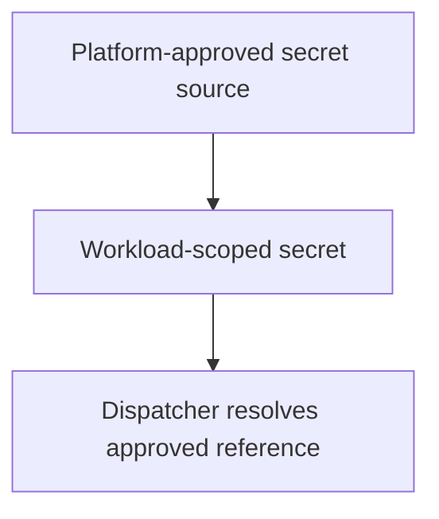

# Dispatcher Credentials and Secrets

## Secret tiers reflect disclosure impact

**Both tiers are sensitive.** Tier describes the potential impact of disclosure, not whether a value is a secret.

- **Tier 1 — platform-impacting or internally revealing credentials.** This includes credentials shared across instances, capable of privileged platform or repository actions, or able to reveal sensitive internal systems or data. Keep them within platform-owned secret and authentication boundaries. Do not make them selectable by instance profiles or expose them to the agent runtime.
- **Tier 2 — workload-scoped, bounded-impact credentials.** Use only when a workload needs a credential and disclosure is not expected to grant platform access or reveal internal information. For example, a dedicated Slack webhook may allow someone to post to its destination; it can still be abused, must be protected, and should be independently revocable. Scope each credential to one workload and its intended use.

The [dispatcher](agent-dispatcher-deployment.md) mints a short-lived memory credential per cycle. For service preflights, the gateway authenticates the request and the proxy supplies upstream vendor credentials. These platform credentials are not delivered to the sandbox as ordinary environment values. Instance repositories contain configuration, not credential material or provider-specific secret locations.

## Planned: workload-scoped sandbox secrets

Dispatcher-managed Tier 2 references are planned but not supported by the current dispatcher. Any implementation must preserve tier boundaries, authorize references before launch, and keep resolved values out of logs and diagnostics.

The proposed profile syntax is `${{ secret('name', 'key') }}` under `sandbox.env`. A profile refers to an approved workload-scoped secret by name and key; it contains neither the credential nor its backing-store location. Authorization and resolution must complete before sandbox creation. Invalid or denied references fail closed. A resolved Tier 2 value is available to the workload that receives it, so disclosure can still cause harm; this mechanism must never pass Tier 1 credentials to agent workloads.
