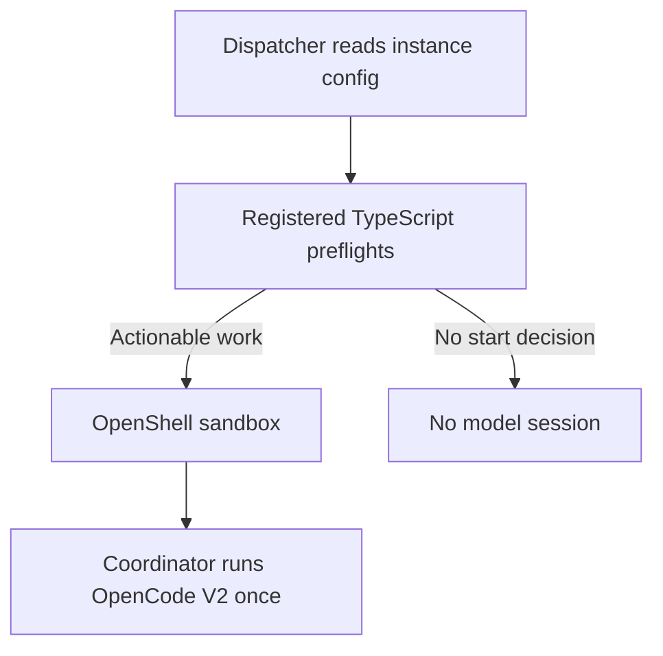

# Řehoř

Řehoř is an autonomous developer tool. A selected workflow discovers
work, implements code changes in target repos, and maintains PRs and MRs
through CI and review. It integrates with Jira Cloud, GitHub, GitLab, and a
PostgreSQL-backed memory server.

## How a dispatched cycle works



The [dispatcher](agent-dispatcher-deployment.md) checks for work before it
creates a sandbox. Only `start` results go into the prompt. The sandbox runner
consumes that prompt once and exits; it does not run preflights again. Cycles
without a model session use no model tokens.

Instance repositories select and configure registered preflights in
`instance.yaml`. If a check doesn't exist, [contribute it to this repository](presets/custom-preflight.md).
The dispatcher does not execute preflight scripts from instance repositories.

## Why

- **Hands-free work execution** — workflow work items get picked up, implemented, and PRed without human intervention
- **Consistent quality** — every PR follows the same patterns: persona-specific coding standards, test verification, visual checks for UI changes
- **Scales across repos** — one bot instance handles multiple repos via label-based routing and fork-based PRs
- **Learns from past work** — completed work is stored as RAG memories, so the bot improves over time
- **Cost-efficient** — preflight scripts filter out "nothing to do" cycles before any AI tokens are spent

## Example dispatcher output

The [FleetShift profile](https://github.com/fleetshift/fleetshift-bot-instance/blob/main/instance/fleetshift-config/agent/instance.yaml) selects dispatcher-managed preflights and OpenCode. On Nov 13, its agent opened [PR #39](https://github.com/stolostron/ocm-fleet/pull/39), proposing a versioned console-config provider for `stolostron/ocm-fleet`: config sources, validation and error states, plugin bootstrap, manifest-asset URL resolution, tests, and usage docs. GitHub showed the PR open at last review; this is proposed work, not a merged change.

## Common Mistakes

**Unused env presets waste build time.** The `node` and `go` presets install version managers and compilers. Skip them if your repos don't need them. See [Env Presets](presets/envs.md).

## Troubleshooting

**Jira sprint workflow isn't picking up tickets:**

- Check that tickets have the correct primary label matching your `BOT_LABEL`
- Tickets must be unassigned — the bot skips assigned tickets
- Verify `repo:<name>` labels match keys in `project-repos.json`
- Check if the bot is at the 10-task capacity limit via the dashboard

**Bot runs but never starts AI sessions:**

- Check dispatcher preflight logs. A `skip` decision means no actionable work was found.
- Verify there are open PRs with CI failures, review feedback, or unassigned sprint tickets
- Look for "error" results in preflight output, which indicate API connectivity issues

Custom workflows have their own source and preflight checks. Use their workflow
documentation instead of applying Jira-specific checks.

For current operational procedures, see the [Operations Overview](operations/index.md).

---

## Documentation

| Section | What you'll find |
|---------|-----------------|
| [Onboarding a New Instance](onboarding-new-instance.md) | Build a runner image and enroll its profile in the dispatcher |
| [Agent Dispatcher Deployment](agent-dispatcher-deployment.md) | Dispatcher deployment contract, configuration, rollout, rollback, observability |
| [Dispatcher Credentials and Secrets](dispatcher-secrets.md) | Platform authentication and tier-2 sandbox secrets |
| [Instance Configuration](presets/instance-config.md) | `instance.yaml`, env-preset selection, and configuration precedence |
| [Bot Workflow Loop](bot-workflow-loop.md) | From preflight decision to sandbox cleanup |
| [Scheduling](scheduling.md) | Current dispatcher cadence and planned per-instance schedules |
| [Debugging Cycles and Improving Agents](debugging-cycles-and-agents.md) | Find cycle transcripts, diagnose decisions, and improve agent behavior safely |
| [Coordinator Runtime Contract](https://github.com/OpenShift-Fleet/rehor/blob/master/coordinator/README.md) | Runtime boundary and lifecycle |
| [Git Auth Proxy](git-auth-proxy.md) | Credential isolation design for the proxy sidecar |
| [Presets Overview](presets/README.md) | How workflow and env presets work together |
| [Workflow Presets](presets/workflows.md) | Built-in workflow reference (jira-sprint) |
| [Env Presets](presets/envs.md) | Available env presets: node, go, browser, container-scan, slack, etc. |
| [Custom Workflows](presets/custom-workflows.md) | Building your own workflow for specialized automation |
| [Dispatcher Preflights](presets/custom-preflight.md) | Configure registered checks or contribute new ones to Řehoř |
| [Preflight Reference](presets/preflight-reference.md) | Registered checks and their input parameters |
| [Roadmap](roadmap.md) | Planned improvements and new capabilities |
| [Operations Overview](operations/index.md) | Daily operations and verification runbooks |

For previous deployment patterns, see [Legacy documentation](legacy/index.md).

## Contributing to these docs

Preview changes locally:

```bash
pip install -r docs/requirements.txt
mkdocs serve
```

Open [http://127.0.0.1:8000](http://127.0.0.1:8000) to preview. Run `mkdocs build --strict` before pushing to catch broken links.
